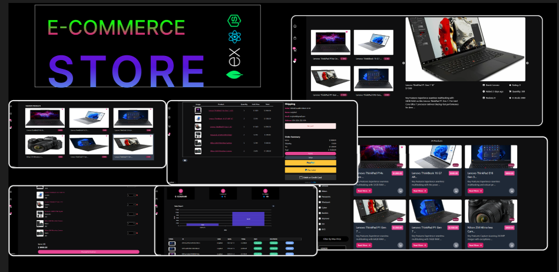

<div align="center">

# 🛒 Mojahed Store

### A Full-Stack E-Commerce Platform

*Built with React 19 · Node.js · MongoDB · Stripe · PayPal*

[](https://mojahed-store.onrender.com/)
[](https://www.typescriptlang.org/)
[](https://react.dev/)
[](https://nodejs.org/)
[](https://www.mongodb.com/)
[](https://www.docker.com/)



</div>

---

## 📖 Overview

**Mojahed Store** is a production-grade, full-stack e-commerce application built entirely in TypeScript — from the React frontend to the Express backend. It demonstrates real-world patterns including dual payment gateway integration (Stripe + PayPal), webhook-driven order automation, JWT-based auth, Cloudinary media management, and a fully containerised deployment setup with Docker.

> Originally inspired by [this YouTube series](https://www.youtube.com/watch?v=PRpTY5LS95M&list=PLSDeUiTMfxW5ymcWAXlbnJ3KLoN34Li_C), the project goes beyond the tutorial with meaningful additions in architecture, tooling, and deployment.

---

## ✨ Features

### 🛍️ Customer Experience
- **Product Browsing** — Filter and search products via a responsive Shop page with sidebar controls
- **Product Details** — Rich product pages with image galleries, ratings, and reviews
- **Favorites** — Save products to a personal wishlist (Redux-persisted)
- **Shopping Cart** — Real-time cart management with localStorage persistence
- **Checkout Flow** — Multi-step checkout: Shipping → Review → Payment
- **Dual Payments** — Pay with **Stripe** (card) or **PayPal** with live webhook order confirmations
- **Order Tracking** — View live order status with progress steps

### 👤 User Management
- **Authentication** — JWT-based login & registration with HTTP-only cookie sessions
- **Profile Management** — Update username, email, and password
- **Order History** — Full view of past orders and their statuses

### 🔧 Admin Panel
| Page | Capabilities |
|------|--------------|
| **Dashboard** | Sales charts, order stats via ApexCharts |
| **User List** | View & manage all registered users |
| **Category List** | Create, update, delete product categories |
| **Product List** | Add new products with Cloudinary image upload |
| **All Products** | Browse and manage the entire product catalog |
| **Order List** | View, track, and manage all customer orders |

### ⚙️ Backend & Infrastructure
- **RESTful API** built with **Express 5** and full TypeScript types
- **Webhook handlers** for both PayPal and Stripe (raw body parsing, signature verification)
- **Cloudinary integration** for image upload, hosting, and deletion
- **Global error handling** with a custom `AppError` class and async wrappers
- **Docker + Docker Compose** for reproducible local and production environments

---

## 🏗️ Architecture

```
Mojahed_Store/
├── backend/                    # Node.js + Express API (TypeScript)
│   ├── config/                 # DB connection (Mongoose)
│   ├── middlewares/            # Auth, error handling, Multer
│   ├── models/                 # User, Product, Category, Order
│   ├── routes/                 # users, products, categories, orders, uploads, webhooks
│   ├── services/               # Cloudinary upload/delete, PayPal service
│   └── utils/                  # AppError, JWT helpers, Stripe client
│
├── frontEnd/                   # React 19 + Vite (TypeScript)
│   └── src/
│       ├── components/         # Shared UI: Header, Modal, Order, CheckoutCard…
│       ├── pages/
│       │   ├── Auth/           # Login, Register, Navigation
│       │   ├── Admin/          # Dashboard, UserList, ProductList, OrderList…
│       │   ├── User/           # Profile, UserOrders
│       │   ├── products/       # ProductDetails, Favorites
│       │   └── orders/         # Shipping, PlaceOrder
│       ├── redux/
│       │   ├── features/       # authSlice, cartSlice, favoriteSlice, shopSlice
│       │   └── services/       # RTK Query APIs: auth, users, products, orders, categories
│       ├── hooks/              # useDebounce, useAutoHeight
│       └── providers/          # StripeProvider wrapper
│
├── Dockerfile                  # Multi-stage build (frontend → backend → serve)
├── docker-compose.yml          # App + MongoDB services
└── package.json                # Root scripts with concurrently
```

---

## 🚀 Tech Stack

| Layer | Technology |
|-------|-----------|
| **Frontend** | React 19, React Router 7, TypeScript 5.9, Vite 7 |
| **State Management** | Redux Toolkit 2, RTK Query |
| **UI / Styling** | Tailwind CSS 4, Flowbite React, React Icons, React Slick |
| **Charts** | ApexCharts + react-apexcharts |
| **Backend** | Node.js 20, Express 5, TypeScript |
| **Database** | MongoDB 7 via Mongoose 9 |
| **Authentication** | JWT (jsonwebtoken) + bcryptjs + HTTP-only cookies |
| **Payments** | Stripe 20 (Cards + Webhooks), PayPal REST SDK (Webhooks) |
| **Media** | Cloudinary SDK 2 + Multer 2 + Formidable 3 |
| **Containerisation** | Docker (node:20-alpine), Docker Compose |
| **Dev Tools** | Nodemon, tsx, concurrently, ESLint |

---

## 🛠️ Getting Started

### Prerequisites

- **Node.js** ≥ 20
- **MongoDB** (local or Atlas)
- **Docker** (optional, for containerised setup)
- Accounts for: **Stripe**, **PayPal Developer**, **Cloudinary**

---

### 1. Clone & Install

```bash
git clone <your-repo-url>
cd Mojahed_Store

# Install root, backend, and frontend dependencies
npm install
cd backend && npm install && cd ..
cd frontEnd && npm install && cd ..
```

---

### 2. Environment Variables

Create a `.env` file in the project root:

```env
# Server
PORT=5000
NODE_ENV=development
CLIENT_URL=http://localhost:5173

# Database
MONGO_URI=mongodb://localhost:27017/mojahed_store

# Auth
JWT_SECRET=your_jwt_secret_here

# Cloudinary
CLOUDINARY_CLOUD_NAME=your_cloud_name
CLOUDINARY_API_KEY=your_api_key
CLOUDINARY_API_SECRET=your_api_secret

# Stripe
STRIPE_SECRET_KEY=sk_test_...
STRIPE_WEBHOOK_SECRET=whsec_...

# PayPal
PAYPAL_CLIENT_ID=your_paypal_client_id
PAYPAL_CLIENT_SECRET=your_paypal_client_secret
PAYPAL_WEBHOOK_ID=your_paypal_webhook_id
```

Create a `.env` file in the `frontEnd/` directory:

```env
VITE_STRIPE_PUBLIC_KEY=pk_test_...
```

---

### 3. Run in Development

```bash
# From the project root — starts both servers concurrently
npm run dev
```

| Service | URL |
|---------|-----|
| Frontend (Vite) | http://localhost:5173 |
| Backend (Express) | http://localhost:5000 |

---

### 4. Run with Docker

```bash
# Build and start the full stack (app + MongoDB)
docker-compose up --build
```

The application will be available at **http://localhost:5000** (backend serves the built frontend in production mode).

---

### 5. Build for Production

```bash
# Build both frontend and backend
npm run build

# Start the production server
npm start
```

---

## 🔌 API Reference

| Method | Endpoint | Description | Auth |
|--------|----------|-------------|------|
| `POST` | `/api/users/auth` | Login | — |
| `POST` | `/api/users/` | Register | — |
| `GET` | `/api/users/profile` | Get profile | 🔒 User |
| `PUT` | `/api/users/profile` | Update profile | 🔒 User |
| `GET` | `/api/users/` | List all users | 🔒 Admin |
| `GET` | `/api/products/` | Get all products | — |
| `GET` | `/api/products/:id` | Get product by ID | — |
| `POST` | `/api/products/` | Create product | 🔒 Admin |
| `PUT` | `/api/products/:id` | Update product | 🔒 Admin |
| `DELETE` | `/api/products/:id` | Delete product | 🔒 Admin |
| `GET` | `/api/category/` | Get all categories | — |
| `POST` | `/api/category/` | Create category | 🔒 Admin |
| `PUT` | `/api/category/:id` | Update category | 🔒 Admin |
| `DELETE` | `/api/category/:id` | Delete category | 🔒 Admin |
| `POST` | `/api/orders/` | Create order | 🔒 User |
| `GET` | `/api/orders/` | List all orders | 🔒 Admin |
| `GET` | `/api/orders/mine` | Get my orders | 🔒 User |
| `PUT` | `/api/orders/:id/pay` | Mark as paid | 🔒 User |
| `POST` | `/api/upload/` | Upload image | 🔒 Admin |
| `POST` | `/api/webhooks/` | PayPal webhook | — |
| `POST` | `/api/stripe/webhook` | Stripe webhook | — |

---

## 💳 Payment Flows

### Stripe
1. Frontend calls backend to create a **PaymentIntent**
2. User completes payment via `@stripe/react-stripe-js` Elements
3. Stripe sends a signed webhook event → backend verifies signature → order marked as **paid**

### PayPal
1. Frontend renders the PayPal button via `@paypal/react-paypal-js`
2. On approval, backend captures the payment via PayPal REST API
3. PayPal sends a webhook event → backend verifies & updates order status

---

## 🌐 Live Demo

🔗 **[mojahed-store.onrender.com](https://mojahed-store.onrender.com/)**

> Deployed on [Render](https://render.com/) with MongoDB Atlas as the database.

---

## 📄 License

This project is open-source and available under the [ISC License](LICENSE).
